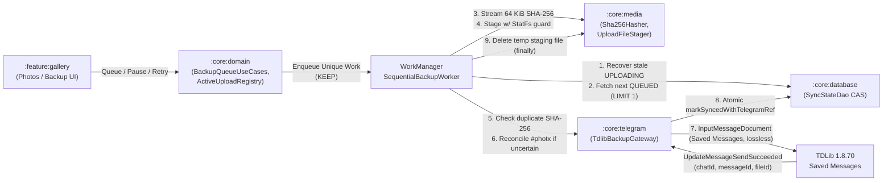
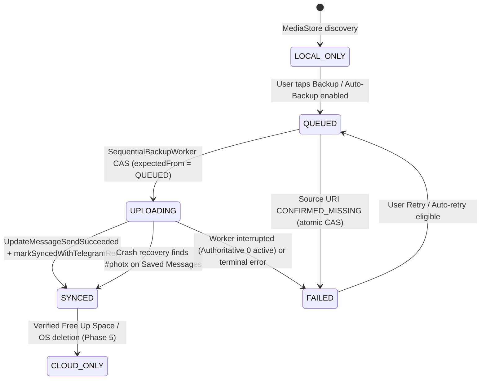

# Phase 3 Architecture: Sequential Auto-Backup (`v0.3.0`)

**Status:** Proposed for Review (`feat/phase3-sequential-auto-backup`)  
**ADRs:** `ADR-005` (Sequential `WorkManager`), `ADR-006` (64 KiB Streaming SHA-256), `ADR-007` (Lossless `InputMessageDocument` + `#photx` Correlation)  
**Non-Negotiable Invariants:**
1. **Global Single-Upload Invariant:** Never more than `1` active upload across the entire app/process.
2. **Zero Duplicate Telegram Uploads:** Never blindly retry an uncertain upload without `#photx` correlation reconciliation.
3. **Zero Data Loss:** Only transition `UPLOADING -> SYNCED` after durable Room persistence of `(telegram_chat_id, telegram_message_id, sha256)`.

---

## 1. Architecture Diagram

---

## 2. Module Responsibility Table

| Module | Phase 3 Responsibility | Forbidden Dependencies / Boundaries |
|---|---|---|
| `:core:model` | Keep `SyncState` (`LOCAL_ONLY`, `QUEUED`, `UPLOADING`, `SYNCED`, `CLOUD_ONLY`, `FAILED`) & `SyncStateTransitionValidator` | Pure Kotlin, zero Android/Room/TDLib |
| `:core:domain` | `BackupScheduler`, `BackupStatusUseCase`, `QueueBackupUseCase`, `ActiveUploadRegistry`, `TelegramBackupGateway` port, `#photx` caption formatter/parser | Pure Kotlin, zero `WorkManager` / TDLib / Room |
| `:core:database` | `SyncStateDao` (`findNextQueued`, `recordLocalSha256`, `findBackedUpBySha256`, `markSyncedWithTelegramRef`, `recoverInterruptedUploads`, `clearSha256IfUnsynced`) | No `WorkManager` or `ContentResolver` |
| `:core:media` | `StreamingSha256Hasher` (`64 KiB` buffer), `UploadFileStager` (`filesDir/upload_staging/`, `StatFs` free-space guard, orphan `.tmp` sweep) | No Room or TDLib |
| `:core:telegram` | `TdlibBackupGateway` (`Saved Messages` chat resolution, `searchChatMessages` `#photx` reconciliation, `InputMessageDocument` send + `UpdateMessageSendSucceeded` await) | No Room or `WorkManager` |
| `:core:data` | `DefaultBackupCoordinator`, `WorkManagerActiveUploadRegistry` (`WorkInfo` -> `Authoritative`), `SequentialBackupWorker` orchestration | Never bypass `SyncStateDao` CAS gates |
| `:feature:gallery` | Wire `Select -> Backup`, Backup tab Pause/Resume/Retry controls, live progress badge on `UPLOADING` item | Never call `WorkManager` or DAOs directly |

---

## 3. Queue State Machine

---

## 4. Core Technical Design

### 4.1 Single-Pass Stage-and-Hash (`:core:media` + `:core:database`)
- **WHAT:** `UploadFileStager.stageAndHash` copies `ContentResolver.openInputStream(uri)` into `filesDir/upload_staging/<itemId>.part.<nanos>` using a fixed `64 KiB` buffer while computing `MessageDigest("SHA-256")` in the **same read pass**, then atomically publishes `<itemId>.staged`.
- **WHY:** Prevents `OutOfMemoryError`, avoids reading multi-gigabyte videos twice, and guarantees the `sha256` digest **always** matches the exact staged bytes submitted to TDLib.
- **HOW:** Verify `StatFs` free space `>= sizeBytes + 50 MiB`, copy + hash with `ensureActive()` checks, `fd.sync()`, rename `.part.<nanos>` → `.staged`, and persist digest via `SyncStateDao.recordLocalSha256`. Inside one `@Transaction` (`linkDuplicateToCanonicalBackup`), check `findBackedUpBySha256(digest)` and atomically copy the canonical backup's Telegram refs to the duplicate without uploading.

### 4.2 Persistent Sequential Queue, Lost-Wakeup Prevention & Global Lease
- **WHAT:** Schedule `"photx_sequential_backup"` via `WorkManager` (`ExistingWorkPolicy.KEEP` + post-lease `APPEND_OR_REPLACE` tail continuation if `countQueued() > 0`) backed by Room's singleton `backup_execution_lease` row (`owner_worker_id`, `active_media_id`, `acquired_at_ms`, `expires_at_ms`).
- **WHY:** Prevents `ExistingWorkPolicy.KEEP` from stranding newly queued items during worker shutdown, and ensures `ActiveUploadRegistry` is backed by a true SQLite mutual-exclusion lease.
- **HOW (`WorkInfo.State` & Transient Retry Behavior):**
  - `RUNNING`: `WorkManagerActiveUploadRegistry` reads `ACTIVE_MEDIA_ID` progress -> `Authoritative(setOf(id))`.
  - `ENQUEUED` / `BLOCKED` / `SUCCEEDED` / `FAILED` / `CANCELLED`: `Authoritative(emptySet())` (worker not executing).
  - **Pre-send `Result.retry()`:** Releases lease in `finally`, item remains `QUEUED` (never `UPLOADING`) while `WorkInfo` is `ENQUEUED` (`BackoffPolicy.EXPONENTIAL`, `30s` base).
  - **Uncertain Telegram send (`upload_attempt_uncertain == 1`):** If Pause, Cancel, network drop, or process death happens *after* `sendMessage` is dispatched, `upload_correlation_token` and `upload_attempt_uncertain = 1` remain persisted; the lease is released in `finally`, and `recoverInterruptedUploads` transitions stale `UPLOADING -> FAILED` (preserving `upload_attempt_uncertain = 1`). No new `sendMessage` is ever permitted until `searchChatMessages` reconciles the previous attempt!

### 4.3 Lossless Telegram Upload & `#photx` Correlation (`:core:telegram`)
- **WHAT:** Upload `.staged` via `TdApi.InputMessageDocument` (`useMessageDatabase = true`) to Saved Messages with `<= 200`-char caption `#photx v1 s:<64-hex> c:<36-uuid>` (`115` chars).
- **HOW:** Persist `upload_correlation_token` + `upload_attempt_uncertain = 1` in Room **before** `sendMessage`, await `UpdateMessageSendSucceeded` (`oldMessageId -> final server messageId`), then atomically call `markSyncedWithTelegramRef` and clear `upload_attempt_uncertain = 0`. Pre-upload recovery validates recovered messages by `chatId`, `senderId == myUserId`, `MessageDocument`, exact `c:<token>` + `s:<sha256>` caption, and expected byte size.

### 4.4 Duplicate Prevention & Crash-Window Recovery
- **Crash Window:** App/network dies *after* Telegram receives the document but *before* Room commits `UPLOADING -> SYNCED`.
- **Recovery Rule:** Whenever an item enters the worker with `syncState == FAILED` (from an interrupted upload) or after an uncertain send timeout, **before** calling `sendMessage(InputMessageDocument)`, `TdlibBackupGateway` calls `searchChatMessages(savedMessagesChatId, query = "sha256:$digest")` (falling back to `"corr:${item.id}"`).
  - **Match found:** Extract `(chatId, messageId, fileId)` and atomically run `markSyncedWithTelegramRef` — **0 bytes re-uploaded**.
  - **No match found:** Safe to upload once via `InputMessageDocument`.

### 4.5 Temporary App-Private File Staging & Disk Safeguards
- **WHAT:** Copy `content://` stream into `context.filesDir/upload_staging/<mediaId>.tmp` only for the single active item, deleting in `finally` and sweeping orphaned staging files older than active work on worker boot.
- **WHY:** TDLib `InputFileLocal` requires a filesystem path rather than an Android `content://` URI.
- **HOW:** Before copying, query `StatFs(filesDir.path).availableBytes` and require `availableBytes >= item.sizeBytes + 50L * 1024 * 1024` (`50 MiB` headroom). If insufficient storage, fail cleanly (`AppError.Io`) without `ENOSPC` crashes.

### 4.6 Resource Constraints
- Fixed `64 KiB` hashing/staging buffer (`O(1)` heap).
- Strict `1` active upload (`ExistingWorkPolicy.KEEP`), zero parallel test uploads/downloads.
- `WorkManager` constraints: `NetworkType.CONNECTED` (plus user preference for `UNMETERED` Wi-Fi-only and `requiresBatteryNotLow = true` for auto-backup).

---

## 5. Failure & Recovery Scenarios

| Scenario | Detection | Recovery Behavior |
|---|---|---|
| Process death mid-hash or mid-staging | Worker restarts; `ActiveUploadRegistry` shows 0 running for old ID | `recoverInterruptedUploads` marks stale `UPLOADING -> FAILED`; startup sweep deletes orphan `.tmp` staging file |
| Crash *after* Telegram accepted message, *before* Room `SYNCED` | Retry / recovery sees `sha256` present + no `telegram_message_id` | Pre-upload `searchChatMessages(sha256)` finds `#photx` message on Saved Messages and calls `markSyncedWithTelegramRef` with zero re-upload |
| User edits unbacked file before upload | `DefaultGalleryRepository` detects `sizeBytes`/`takenAt` change | Clears `sha256 = NULL` on unsynced row; worker re-hashes fresh content |
| Source photo deleted from device while `QUEUED` | `MediaUriExistenceProbe` returns `CONFIRMED_MISSING` | Atomic CAS `QUEUED -> FAILED` (`expectedFrom = QUEUED`), queue advances |
| Insufficient internal storage for large video staging | `StatFs` check `< sizeBytes + 50 MiB` | Skips staging, transitions `UPLOADING -> FAILED` with storage error |
| Network lost or TDLib `429` flood-wait | TDLib error / connectivity drop | Deletes staging file, transitions `UPLOADING -> QUEUED`, returns `Result.retry()` with exponential backoff |
| Duplicate copy of already-backed-up photo | `SyncStateDao.findBackedUpBySha256(digest)` returns canonical row | Skips Telegram upload; surfaces duplicate/already-backed-up status cleanly |

---

## 6. Proposed Implementation Increments

- **Increment 3A (`:core:media` + `:core:database`):** `StreamingSha256Hasher`, `UploadFileStager` (`StatFs` + orphan sweep), `SyncStateDao.findNextQueued` & unsynced hash invalidation, unit/Robolectric tests.
- **Increment 3B (`:core:domain` + `:core:telegram`):** `#photx` caption codec, `TelegramBackupGateway`, TDLib `InputMessageDocument` + `UpdateMessageSendSucceeded` + `searchChatMessages` reconciliation, fake-TDLib crash-window tests.
- **Increment 3C (`:core:data` + `:app`):** `SequentialBackupWorker`, `WorkManagerActiveUploadRegistry`, `BackupScheduler`, `WorkManagerTestInitHelper` sequential & retry tests.
- **Increment 3D (`:feature:gallery` + Emulator Smoke Test):** Wire `Select -> Backup` and Backup tab `Backup Now` / `Pause` / `Retry`, verify end-to-end live upload to `@PrinceJr` Saved Messages on `PhotX_API_36_x86_64`.

---

## 7. Testing Strategy

- **Unit (`:core:media`, `:core:domain`):** `64 KiB` streaming SHA-256 accuracy & cancellation, `StatFs` low-space rejection, staging cleanup on success/error, `#photx` caption round-trip & malformed caption rejection.
- **Database (`:core:database`):** Room WAL tests for `findNextQueued`, hash invalidation on unsynced metadata change, and `markSyncedWithTelegramRef` duplicate rejection (`RejectedDuplicateBackup`).
- **Gateway & Crash-Window (`:core:telegram`, `:core:data`):** Fake TDLib gateway tests simulating post-send crash before Room commit, proving `searchChatMessages` recovers `(chatId, messageId)` with `uploadCalls == 0` on retry.
- **WorkManager (`:core:data`):** `WorkManagerTestInitHelper` verifying `ExistingWorkPolicy.KEEP`, single-active-upload progress reporting to `WorkManagerActiveUploadRegistry`, pause/cancel, and exponential retry.
- **Live Emulator (`PhotX_API_36_x86_64`):** Real `InputMessageDocument` upload of `botanical_orchid.jpg` to Saved Messages, verifying `#photx` caption, `SYNCED` badge, SHA-256 preservation, and `0` duplicates on force-stop recovery.
